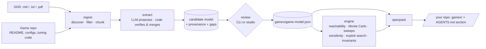

# GameX Engine

**Turn a game idea into a buildable, testable, repo-native spec.**

GameX Engine reads a game design document (GDD), and optionally your game repo, and turns it into one
canonical **Game Model**. You review every item it found. It then explores the model with **deterministic
simulation**: reachability, Monte Carlo players, parameter sweeps, sensitivity and exploit search. Finally
it writes a **Spec Pack** into your repo (`AGENTS.md`, balance files, formulas, backend contracts, golden
tests and build tasks) so coding agents such as Claude Code, Codex or Cursor can build the game backend
straight from it.

It is aimed at game designers, economy designers, product managers and studios building mobile and
hybrid-casual games, including ad-monetized ones (rewarded, interstitial, banner, MREC, IAP).

> **Status:** Phases 0–5 are done (foundation, Game Model, engine, Spec Pack + CLI, ingestion & extraction,
> studio). Phase 6 (drift detection + CI template) and Phase 7 (MCP server + Git app) are planned.
> See [`docs/PLAN.md`](docs/PLAN.md).

---

## Contents

- [How it works](#how-it-works)
- [Core principles](#core-principles)
- [Quick start](#quick-start)
- [The CLI](#the-cli)
- [The studio](#the-studio)
- [The Game Model](#the-game-model)
- [The engine](#the-engine)
- [Ingestion and extraction](#ingestion-and-extraction)
- [The Spec Pack](#the-spec-pack)
- [Repository layout](#repository-layout)
- [Development](#development)
- [The Swarm Rescue fixture](#the-swarm-rescue-fixture)
- [Roadmap](#roadmap)
- [Documentation](#documentation)
- [License](#license)

---

## How it works



1. **Ingest:** GameX lists the files it would read, applying `.gitignore`, a secrets deny-list, an
   extension allowlist and size limits, and asks you to confirm.
2. **Extract:** an LLM (Claude by default) proposes entities, resources, constants, variables, actions,
   rules, screens, flows and ad placements, each with a quote from the source. Deterministic code checks
   every quote against the source, merges, repairs and records gaps (open questions).
3. **Review:** you accept, edit or reject every item, in the terminal or in the browser. Nothing reaches
   the canonical model without a review decision.
4. **Explore:** the engine simulates the model with a seeded PRNG. Same model and seed give
   byte-identical results, in Node or in a browser.
5. **Sync:** GameX writes the Spec Pack into `gamex/` and a delimited block of `AGENTS.md`. Golden tests are
   computed by the engine, and an independent reference runner shipped in the pack checks them.

## Core principles

| Principle                          | What it means in practice                                                                                                                                                                        |
| ---------------------------------- | ------------------------------------------------------------------------------------------------------------------------------------------------------------------------------------------------ |
| **One canonical Game Model**       | The engine, studio, Spec Pack and drift checker all read a `GameModel` parsed by `@gamex/model`. Nothing bypasses it.                                                                            |
| **The LLM proposes, code decides** | LLM output is never used as a number, a simulation result or a test expectation. The engine and Spec Pack cannot depend on any LLM code.                                                         |
| **Provenance on every node**       | Source file, location, excerpt, confidence and status (`detected`, `confirmed`, `edited`, `assumed`) are required fields.                                                                        |
| **Determinism**                    | `model` and `engine` are pure: no I/O, no clock, no `Math.random`, no platform floating-point functions. A seeded PRNG and in-house math are used instead. CI compares Node and Chromium output. |
| **Repo safety**                    | Target-repo files are read only through `SafeFileSystem`. `.env*`, keys, certificates and credential files are never read or sent anywhere.                                                      |
| **Repo-native output**             | GameX writes files into your repo; you never copy and paste. Writes stay inside `gamex/`, the `AGENTS.md` block and create-if-missing shims.                                                     |
| **Honest scope**                   | Reports say "explored N states / M players / K seeds", never "all possible outcomes".                                                                                                            |

## Quick start

Requirements: **Node ≥ 22.18** and **pnpm 10** (via Corepack).

```bash
corepack enable
```

```bash
pnpm install
```

```bash
pnpm build
```

```bash
node packages/cli/dist/gamex.js doctor
```

### From a design document

Point GameX at a game repo containing a GDD. It lists the files it would send, asks for confirmation,
extracts a candidate model, walks you through review and writes the Spec Pack:

```bash
ANTHROPIC_API_KEY=… node packages/cli/dist/gamex.js init --cwd path/to/game-repo
```

No API key? `--provider agent` lets your own agent session answer the extraction requests, and
`--provider recorded` replays saved answers (used by tests and demos). `GAMEX_MODEL` picks the Claude model.

### From an existing Game Model

If the repo already has `gamex/game-model.json`:

```bash
node packages/cli/dist/gamex.js validate --cwd path/to/game-repo
```

```bash
node packages/cli/dist/gamex.js sim --cwd path/to/game-repo --seed 42 --days 7 --players 100
```

```bash
node packages/cli/dist/gamex.js sync --cwd path/to/game-repo
```

### In the browser

```bash
node packages/cli/dist/gamex.js studio --cwd path/to/game-repo
```

Open the link it prints (127.0.0.1 only, with a per-launch token).

## The CLI

`gamex <command> [--json] [--cwd <repo>]`

| Command    | What it does                                                                                                                                            |
| ---------- | ------------------------------------------------------------------------------------------------------------------------------------------------------- |
| `doctor`   | Check the environment and installation.                                                                                                                 |
| `ingest`   | Discover and list the files that would be read; confirm them.                                                                                           |
| `extract`  | Run LLM extraction into a candidate model (`--provider anthropic\|agent\|recorded`).                                                                    |
| `review`   | Accept, edit or reject each detected item; writes `gamex/game-model.json`.                                                                              |
| `init`     | `ingest → extract → review → sync` in one go.                                                                                                           |
| `validate` | Check schema, references, formulas, ranges and design rules, with located, actionable errors.                                                           |
| `sim`      | Deterministic Monte Carlo simulation, or a sweep. Options include `--seed`, `--days`, `--players`, `--persona`, `--param key=value`, `--lhs --samples`. |
| `explore`  | Reachability, never-true conditions, exploit search and ad-placement safety.                                                                            |
| `sync`     | Write or update the Spec Pack (`--dry-run`, `--force`, `--sensitivity`, `--seed`, `--days`, `--players`).                                               |
| `studio`   | Serve the studio locally (`--recordings <dir>` enables recorded extraction).                                                                            |

Conventions:

- `--json` prints exactly one JSON document to stdout (`{ ok, command, data, issues }`); human output and
  progress go to stderr, so agents and CI can consume every command.
- Exit codes: `0` ok, `1` findings or validation failure, `2` usage error, `3` I/O or LLM error.
- Working files live in `gamex/.work/` (gitignored).

## The studio

A Vite + React app (`apps/studio`) for doing the whole flow without the terminal: upload a GDD, review
items, tune constants with sliders, simulate, compare variants and write the Spec Pack.

- **Views:** sources, review, parameters, graphs (entity map, economy graph and state machine via React
  Flow + ELK), scenario, outcomes (ECharts time series, distributions, sensitivity tornado), A/B compare
  and Spec Pack preview.
- **Worker pool:** the engine runs in up to four Web Workers. A run is split into player ranges and merged,
  and because every player has its own seeded stream the output hash equals `gamex sim`'s.
- **Variants A and B** are parameter override sets run with the same seed (common random numbers), so
  differences come from the parameters alone. "Save variant" writes them into the model.
- **Two modes, one bundle:** served by `gamex studio` (server mode: I/O, extraction and writes go through
  the local API, which keeps `ANTHROPIC_API_KEY` server-side), or as a static site from
  `apps/studio/dist` (import a `game-model.json`, download the Spec Pack as a zip; no extraction).
- Light and dark themes, accessible Okabe–Ito palettes, no web fonts, CDNs or analytics; works offline.
- The browser never imports `ingest`, `extract`, `drift`, `cli` or `specpack/node` (enforced by
  dependency-cruiser). Uploads land only in `gamex/sources/`.

## The Game Model

Everything GameX knows about a game lives in one canonical JSON file, `gamex/game-model.json`, validated
by Zod schemas in `@gamex/model` (a JSON Schema is generated at
`packages/model/schema/game-model.schema.json`).

| Section                                  | Contents                                                                                                                                    |
| ---------------------------------------- | ------------------------------------------------------------------------------------------------------------------------------------------- |
| `meta`                                   | Name, genre, platforms, target markets, schema and model versions, content hash.                                                            |
| `entities`                               | Characters, heroes, enemies, NPCs, items, buildings.                                                                                        |
| `resources`                              | Soft and hard currency, energy, XP, keys, tickets, with caps and starting values.                                                           |
| `constants`                              | Tunable values with unit, min, max and step, plus first-class curves (linear, geometric, table, piecewise). These become the balance files. |
| `variables`                              | Mutable state scoped to `player`, `session`, `mission` or `global`.                                                                         |
| `actions`                                | What players or the system can do: preconditions, costs, effects, cooldowns, per-scope limits, randomness.                                  |
| `rules`                                  | Invariants and policies, e.g. "max 1 revive per mission", with severity.                                                                    |
| `stateMachine`                           | Screens and modes with guarded transitions: win, lose, retry, pause, next level, exit.                                                      |
| `flows`                                  | Economy graph nodes: source, sink, converter, gate, pool.                                                                                   |
| `monetization`                           | Ad and IAP placements with triggers, eligibility, caps, cooldowns, rewards and forbidden states.                                            |
| `personas`, `kpis`, `invariants`, `gaps` | Simulated player types, measured KPIs, designer-defined checks and open questions.                                                          |

Ids are kebab-case; each node also has a camelCase `key` (derived with `idToKey`) used in expressions,
balance files and golden tests. Files are always written in canonical form (`serializeGameModel`).

### Expression language

Preconditions, rules and eligibility use a small, total, side-effect-free language stored as strings:

```
revivesUsedThisMission < maxRevivesPerMission
missionLevel >= interstitialMinLevel && lastMissionResult == "victory"
now - interstitialAfterVictoryLastAt >= interstitialMinGapSeconds
curve(upgradeCost, damageTier + 1)
```

It has literals, identifiers, the usual arithmetic, comparison and logical operators, a ternary, and a fixed
function whitelist (`min max clamp abs floor ceil round curve eligible`). A Pratt parser keeps source spans
for located errors ("did you mean …?"), a static type checker resolves identifiers against the model, and
division by zero is a typed error, never `NaN`. Property-based tests cover round-tripping, totality and
determinism. Full reference: [`docs/GAME_MODEL.md`](docs/GAME_MODEL.md).

## The engine

`@gamex/engine` is pure TypeScript that runs unchanged in Node, Vitest and Web Workers.

- **Rule interpreter** (`step.ts`): the only place rules are enforced. Step order, sessions, policy and churn
  semantics are fixed in [ADR 0006](docs/DECISIONS/0006-engine-semantics.md).
- **Determinism:** seeded PRNG with per-player streams, deterministic math module (`dmath.ts`), time as an
  input. Same model + seed ⇒ byte-identical output regardless of worker count.
- **Reachability** over the state machine, finding unreachable screens, dead ends and never-true conditions.
- **Monte Carlo simulation** of personas over days, with KPI statistics.
- **Sweeps and sensitivity** (including Latin hypercube sampling) to rank constants by KPI impact.
- **Exploit search** for adversarial action sequences that break the economy or ad rules.
- **Invariant evaluation** against simulation output.

## Ingestion and extraction

- **`@gamex/ingest`:** `SafeFileSystem`, file discovery, readers (Markdown, text, PDF, JSON/YAML/TOML,
  C#, GDScript, TS, Unity `.asset`) and chunking with line numbers for provenance. A deny-list
  (`packages/ingest/src/deny-list.ts`) blocks secrets and is tested against planted `.env`, `*.pem` and
  `id_rsa` files.
- **`@gamex/extract`:** an `LlmProvider` interface (Anthropic, agent and recorded providers), extraction
  passes using structured output, then `assembleCandidate` verifies quotes against the source, merges
  duplicates, repairs references deterministically and records gaps. See
  [ADR 0008](docs/DECISIONS/0008-extraction-and-review.md).

## The Spec Pack

`gamex sync` renders the model (pure `renderSpecPack`) and writes it (`writeSpecPack` from
`@gamex/specpack/node`) into your repo:

```
AGENTS.md                ← only the <!-- GAMEX:BEGIN v1 --> … <!-- GAMEX:END --> block is managed
CLAUDE.md, GEMINI.md     ← thin shims, created only if missing
gamex/
  game-model.json        ← source of truth (canonical JSON)
  schema/                ← JSON Schema for the model
  balance/*.json         ← constants and curves, keyed by constant key
  RULES.md               ← rules and formulas, with editable narrative regions
  backend/openapi.yaml   ← OpenAPI 3.1: one POST per action, idempotency keys, error-code enums
  backend/data-model.sql ← PostgreSQL schema with checks mirroring the model
  tests/golden/*.json    ← golden cases per action and placement, computed by the engine
  tests/runner/          ← zero-dependency reference interpreter + run-golden.ts (plain node)
  tasks/NNN-*.md         ← ordered build tasks, each defined by golden-test ids
  skills/*/SKILL.md      ← portable agent skills
  reports/latest-sim.md  ← simulation report
  .gamex-lock.json       ← hashes of everything GameX wrote
```

- **Ownership classes** (`generated`, `editable`, `section`, `create-if-missing`, `source`) decide how each
  file is treated. A hand-edited generated file is reported as a conflict; nothing is written unless
  `--force`.
- **Idempotent:** no timestamps or absolute paths, stable ordering, atomic writes; running `sync` twice
  changes nothing.
- **Golden tests** cover accepted outcomes, boundary values of every limit, cooldown and cost, one falsified
  case per precondition, rule and eligibility condition, and forbidden-screen cases for placements. A backend
  in any language is done when it produces the same `then` for every `given/when`.
- The **reference runner** is an independent re-implementation of the rules; CI checks it agrees with the
  engine on every case.

Format details: [ADR 0007](docs/DECISIONS/0007-spec-pack-format.md).

## Repository layout

```
packages/model      @gamex/model     Zod schemas, ids/keys, expression language, validation   (pure)
packages/engine     @gamex/engine    PRNG, rule interpreter, simulation, exploration          (pure)
packages/ingest     @gamex/ingest    SafeFileSystem, deny-list, readers, chunking
packages/extract    @gamex/extract   LlmProvider, extraction passes, merge, gaps
packages/specpack   @gamex/specpack  Spec Pack renderers (pure) + Node writer
packages/drift      @gamex/drift     Drift detection (Phase 6; scaffold only)
packages/cli        @gamex/cli       the `gamex` binary
apps/studio         @gamex/studio    Vite + React studio
fixtures/           @gamex/fixtures  Swarm Rescue GDD, sample repo, fixture tests
tooling/                             shared Vitest config
docs/                                architecture, plan, Game Model reference, ADRs
```

Dependency rules (checked by dependency-cruiser): no cycles; `model` and `engine` depend on nothing with I/O;
`engine` and `specpack` never depend on `extract` or an LLM SDK; the studio uses only browser-safe packages.

## Development

Stack: TypeScript (strict, `noUncheckedIndexedAccess`, `exactOptionalPropertyTypes`), ESM only, pnpm
workspaces + Turborepo, Zod, Vitest + fast-check, ESLint + Prettier, Playwright, GitHub Actions.

| Command                                          | What it does                                                                   |
| ------------------------------------------------ | ------------------------------------------------------------------------------ |
| `pnpm build`                                     | Build every package (`tsc -b`), the CLI bundle (`tsup`) and the studio (Vite). |
| `pnpm typecheck`                                 | Type-check sources and tests.                                                  |
| `pnpm test`                                      | Vitest with coverage (≥ 85 % enforced for `model` and `engine`).               |
| `pnpm lint`                                      | Type-aware ESLint (zero warnings) + Prettier check.                            |
| `pnpm depcruise`                                 | Architecture rules (run after `pnpm build`).                                   |
| `pnpm check`                                     | All of the above, in CI order.                                                 |
| `pnpm --filter @gamex/<pkg> test`                | Test one package.                                                              |
| `pnpm --filter @gamex/studio test:e2e`           | Playwright E2E of the built studio and CLI.                                    |
| `pnpm --filter @gamex/model gen:schema`          | Regenerate the JSON Schema after changing the Zod schema.                      |
| `pnpm --filter @gamex/specpack gen:templates`    | Re-embed the reference runner after editing it.                                |
| `pnpm --filter @gamex/fixtures record`           | Re-hash the Swarm Rescue recordings (`--live` records real answers).           |
| `GAMEX_LIVE=1 pnpm --filter @gamex/extract test` | Opt-in live extraction test (needs `ANTHROPIC_API_KEY`).                       |

The browser-determinism test (`packages/engine/test/browser-determinism.test.ts`) needs Chromium:
set `PLAYWRIGHT_BROWSERS_PATH` or run `pnpm --filter @gamex/engine exec playwright install chromium`.

**Definition of done:** `pnpm lint && pnpm typecheck && pnpm test && pnpm build && pnpm depcruise` pass from a
clean checkout, and the change has tests that would fail without it. Contributor and agent rules are in
[`AGENTS.md`](AGENTS.md); conventional commits, ADRs for non-trivial choices.

## The Swarm Rescue fixture

`fixtures/swarm-rescue/` is the end-to-end test case: a GDD for a hybrid-casual mission game with heroes,
upgrades, revives and rewarded / interstitial ads, a tiny sample repo (README, economy config, C# tuning
class), the reviewed `swarm-rescue.game-model.json` (validates with zero errors and warnings) and recorded
LLM answers for offline extraction tests. `sample-repo/.env` is a planted canary, not a secret: tests assert
it is never read or sent.

## Roadmap

| Phase | Scope                                                                        | Status  |
| ----- | ---------------------------------------------------------------------------- | ------- |
| 0     | Foundation: monorepo, tooling, CI                                            | ✅ done |
| 1     | Game Model: schema, expressions, validation                                  | ✅ done |
| 2     | Engine: interpreter, simulation, exploration                                 | ✅ done |
| 3     | Spec Pack + CLI                                                              | ✅ done |
| 4     | Ingestion & extraction                                                       | ✅ done |
| 5     | Studio                                                                       | ✅ done |
| 6     | Drift detection (`gamex drift`, `reports/drift.md`) + GitHub Action template | planned |
| 7     | MCP server and PR-based Git app                                              | later   |

## Documentation

- [Architecture](docs/ARCHITECTURE.md): for designers and engineers
- [Game Model reference](docs/GAME_MODEL.md)
- [Phase plan](docs/PLAN.md)
- [Decisions (ADRs)](docs/DECISIONS/)
- [Product brief](docs/MASTER_PROMPT.md)
- [Agent instructions](AGENTS.md)

## License

[Apache-2.0](LICENSE). See also [`NOTICE`](NOTICE).
