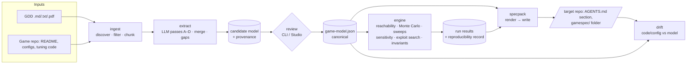
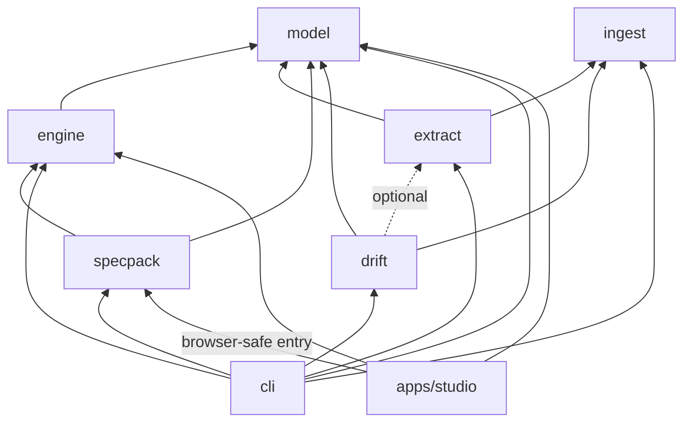

# GameSpec Studio — Architecture

> Status: **DRAFT v0.1 — awaiting approval.** Items marked **⟨Q n⟩** depend on the clarifying
> questions in [`PLAN.md`](./PLAN.md#clarifying-questions); the text shows the recommended default.
> This document is written for both game designers and engineers. Designer-facing summaries are
> in the boxed "In plain words" notes.

---

## 1. What we are building

GameSpec turns a game design (a GDD and/or an existing game repo) into a **canonical Game Model**,
lets a human review every detected item, explores the model's outcomes with **deterministic**
simulation, and writes a **Spec Pack** into the game repo that coding agents build the backend from.



> **In plain words:** everything the tool knows about your game lives in one file,
> `game-model.json`. The AI only *suggests* entries for that file; you approve them. All numbers —
> simulation results, test expectations — are computed by ordinary, tested code, so the same input
> always gives the same answer.

### 1.1 Architectural invariants (enforced, not aspirational)

| Principle | How it is enforced |
|---|---|
| One canonical model | Every consumer (`engine`, `specpack`, `drift`, `studio`) takes a `GameModel` value produced by `@gamespec/model`'s `parseGameModel()`. There is no other input type. |
| LLM proposes, code decides | `engine` and `specpack` have no dependency on `extract` or any LLM SDK (lint rule + dependency-cruiser check in CI). Golden-test expectations are produced by the engine's rule interpreter. |
| Provenance on everything | Every node schema extends `NodeBase = { id, key, provenance, … }`; provenance is a required Zod field. |
| Determinism | No `Math.random`, `Date.now`, `new Date()` or `Math.{exp,log,pow,sin,cos,…}` in `model`/`engine` (ESLint `no-restricted-properties/globals`). Seeded PRNG + in-house deterministic math (§4.2). Byte-identical output tested in CI. |
| Repo safety | All file reads in a target repo go through `ingest`'s `SafeFileSystem`, which applies `.gitignore`, a deny-list (secrets) and an allowlist (extensions + size). Tested with planted `.env`, `*.pem`, `id_rsa`. |
| Honest scope | Reports say "explored N states / M players / K seeds", never "all outcomes". |

---

## 2. Monorepo layout & dependency graph

```
/AGENTS.md  /CLAUDE.md
/docs/{MASTER_PROMPT,ARCHITECTURE,PLAN}.md  /docs/DECISIONS/NNNN-*.md
/packages/
  model/      @gamespec/model     Zod schemas, types, expression language, validation, JSON Schema gen
  engine/     @gamespec/engine    PRNG, interpreter, reachability, sim, sweeps, sensitivity, exploits, invariants
  ingest/     @gamespec/ingest    SafeFileSystem, discovery, readers (md/txt/pdf/json/yaml/toml/cs/gd/ts/asset), chunking
  extract/    @gamespec/extract   LlmProvider, pass prompts, structured-output calls, merge/dedupe, gaps
  specpack/   @gamespec/specpack  pure renderers (model → FileMap) + Node writer + AGENTS.md section manager
  drift/      @gamespec/drift     deterministic config/code scanners + optional LLM re-extraction, diff, report
  cli/        @gamespec/cli       `gamespec` binary (commander), --json everywhere, `studio` server
/apps/studio/                     Vite + React app (talks to engine in a Worker; to CLI server for I/O + LLM)
/fixtures/swarm-rescue/           GDD.md, sample-repo/, swarm-rescue.game-model.json, expected outputs
/tooling/                         shared tsconfig / eslint config / test helpers
/.github/workflows/ci.yml
```



Rules:

- **`model` and `engine` are pure**: no `node:*` imports, no I/O, no globals, no LLM. They run
  unchanged in Node, Vitest, and a Web Worker.
- `specpack` exposes two entry points: `@gamespec/specpack` (pure: `renderSpecPack(model, results) → FileMap`,
  browser-safe, used by the studio preview) and `@gamespec/specpack/node` (`writeFileMap(repoRoot, fileMap)`).
- `ingest` has the only code allowed to touch a target repo's filesystem for *reading*; `specpack/node`
  is the only code allowed to *write* to it.
- No cycles (checked by `dependency-cruiser` in CI).
- ESM-only, TypeScript `strict` + `noUncheckedIndexedAccess` + `exactOptionalPropertyTypes`.
- Libraries build with `tsc -b` (project references, `.d.ts` emitted); the CLI is additionally bundled
  with `tsup` into a single executable JS file; the studio builds with Vite.

---

## 3. The Game Model (`@gamespec/model`)

### 3.1 Top-level shape

```ts
GameModel = {
  meta:          Meta,               // name, genre, platforms[], targetMarkets[], schemaVersion, modelVersion, contentHash
  entities:      Entity[],
  resources:     Resource[],
  constants:     Constant[],         // scalars and curves → balance files
  variables:     Variable[],         // mutable state, scoped
  actions:       Action[],           // player/system "methods"
  rules:         Rule[],             // policies & invariants evaluated at action time
  stateMachine:  { initial: StateRef, states: State[], transitions: Transition[] },
  flows:         FlowNode[],         // source | sink | converter | gate | pool  + edges
  monetization:  { placements: Placement[], forbiddenStates: StateRef[], assumptions: RevenueAssumptions },
  personas:      Persona[],
  kpis:          Kpi[],
  invariants:    Invariant[],        // evaluated against simulation output
  gaps:          Gap[],
}
```

Every node extends:

```ts
NodeBase = {
  id: string;          // stable kebab-case, unique within its section, e.g. "max-revives-per-mission"
  key: string;         // camelCase identifier derived from id, used in expressions/code/golden tests ⟨Q2⟩
  name?: string; description?: string; tags?: string[];
  provenance: Provenance;
}
Provenance = {
  source: string;               // repo-relative path, or "gamespec:assumed"
  location: string;             // "§4.2 / lines 88–94", "p.7", "Assets/Tuning/Economy.asset:L14"
  excerpt: string;              // ≤ 200 chars
  confidence: "high" | "medium" | "low";
  status: "detected" | "confirmed" | "edited" | "assumed";   // + "rejected" via review ledger ⟨Q4⟩
  alternatives?: { source, location, excerpt, value }[];    // conflicting evidence (GDD vs code)
}
```

**References** between nodes use typed prefixes so they are unambiguous and checkable:
`const:interstitial-min-gap-seconds`, `var:revives-used-this-mission`, `res:coins`,
`state:s11-victory`, `action:revive-request`, `rule:max-one-revive-per-mission`, `persona:casual-non-payer`.
(The golden-test example in the master prompt already uses `rule:…`.)

### 3.2 Constants and curves

```ts
Constant = NodeBase & {
  unit: string;  // "seconds" | "coins" | "count" | "ratio" | …
  value: number | Curve;
  min?: number; max?: number; step?: number;     // required for anything sweepable
  integer?: boolean;
  balanceFile: string;                           // which gamespec/balance/<file>.json it is written to
}
Curve =
  | { type: "linear",    params: { base, perStep, from?: 1 } }
  | { type: "geometric", params: { base, ratio, from?: 1 } }        // base * ratio^(n-from), exact integer powering
  | { type: "table",     params: { values: number[], from?: 1, clamp: true } }
  | { type: "piecewise", params: { segments: { untilInclusive: number, curve: Curve }[] } }
  & { rounding: "none" | "floor" | "ceil" | "round-half-even", min?: number, max?: number }
```

Curves are evaluated by one function, `evalCurve(curve, n)`, which is also emitted verbatim (as
dependency-free TypeScript) into `gamespec/formulas/reference.ts`, so game backends and our engine
share one definition.

### 3.3 Variables, actions, rules

```ts
Variable  = NodeBase & { scope: "player"|"session"|"mission"|"global", type: "int"|"number"|"bool"|"enum"|"timestamp",
                         initial: Expr | literal, enumValues?: string[], resetOn?: StateRef[] }
Action    = NodeBase & {
  actor: "player" | "system" | "ad-sdk" | "store",
  preconditions: Expr[],                  // all must be true
  costs:   { resource: ResRef, amount: Expr }[],
  effects: Effect[],                      // { set|add|sub|grant|consume, target, value: Expr } — applied atomically
  cooldown?: { seconds: Expr, scope },    // implemented via an implicit last-used timestamp variable
  limits?:   { max: Expr, per: "mission"|"session"|"day"|"lifetime" }[],
  outcomes?: { id, weight: Expr, effects: Effect[], next?: StateRef }[],   // randomness (e.g. mission win/lose) ⟨Q8⟩
  duration?: Expr,                        // simulated seconds the action takes
  errorCode: string,                      // e.g. REVIVE_LIMIT_REACHED, used by golden tests + openapi
}
Rule      = NodeBase & { appliesTo: ActionRef[] | StateRef[] | "always", expr: Expr,
                         severity: "blocking" | "warning", errorCode: string }
```

Cooldowns and per-scope limits are sugar: the model normalizer desugars them into implicit
variables + rules, so the interpreter has exactly one enforcement path (and so do golden tests).

### 3.4 State machine

`State = NodeBase & { kind: "loading"|"menu"|"meta"|"gameplay"|"result"|"overlay"|"ad"|"exit", tags }`.
`Transition = NodeBase & { from, to, trigger: ActionRef | "auto", guard?: Expr, effects?: Effect[] }`.
`overlay` states (Pause) are modelled as a push/pop stack so "resume returns to where you were" is
expressible without duplicating transitions. `gameplay`-kind states are what the "no UI ads during
live gameplay" rule refers to.

### 3.5 Monetization

`Placement = NodeBase & { format, trigger: { action } | { state }, eligibility: Expr[], caps: [...], cooldownSeconds?: Expr,
reward?: Effect[], forbiddenIn?: StateRef[], inWorld?: boolean }`. Interstitial pacing
("≥180 s apart, max 1/mission, from Level 3, never after defeat") is expressed as ordinary
eligibility expressions + caps over model variables — no special-cased ad logic in the engine.
`RevenueAssumptions` holds eCPM per format per market and fill rate as constants (status `assumed`
until the user supplies real numbers) ⟨Q9⟩.

### 3.6 Personas, KPIs, invariants, gaps

- `Persona` = session frequency/length distributions, skill distribution, ad opt-in probability per
  rewarded placement, purchase probability, churn sensitivity, and an optional action-preference policy.
- `Kpi` = a built-in metric id (progression speed, inflation, faucet/sink ratio, …) or a custom
  aggregate expression over the trace.
- `Invariant` = `{ expr over results, quantifier: "all-runs" | { atLeast: ratio }, scope: persona? }`.
- `Gap` = `{ id, kind: "missing"|"ambiguous"|"contradiction"|"assumption", question, relatedRefs[], blocking }`.

### 3.7 Expression language ⟨Q2⟩

A tiny, total, side-effect-free language. **Stored as strings** in the model for readability
(designers and LLMs both write it naturally), parsed to an AST at load time; the AST is cached and
also serializable.

```
revivesUsedThisMission < maxRevivesPerMission
level >= 3 && lastState != "s14-defeat" && now - lastInterstitialAt >= interstitialMinGapSeconds
min(coins + reward * multiplier, coinsCap)
curve(upgradeCost, tier)
```

- Grammar: literals (number, bool, string), identifiers (`key`s of variables/constants/resources and a
  few built-ins: `now`, `state`, `prevState`, `persona.*`), unary `! -`, binary `* / % + - < <= > >= == != && ||`,
  ternary `?:`, function calls from a fixed whitelist: `min max clamp abs floor ceil round curve count has`.
- Pratt parser → AST with source spans (for located errors: `rules[3].expr: col 14: unknown identifier "revivesUsed"; did you mean "revivesUsedThisMission"?`).
- Static type checker (number / bool / string-enum) resolving identifiers against the model.
- Evaluator is a pure function `(ast, env) → value`; no `eval`/`Function`; division by zero and
  non-finite results are typed errors, not `NaN`.
- Property-based tests (fast-check): print→parse round-trip, evaluator vs. a reference oracle on random
  ASTs, totality (never throws for well-typed ASTs), determinism.

### 3.8 Validation

`validateGameModel(json) → { ok, model?, issues: Issue[] }`, in layers, all issues collected (not fail-fast):

1. **Schema** (Zod) with JSON-pointer paths.
2. **Identity**: id format, uniqueness, `key` collisions.
3. **References**: every `const:/var:/res:/state:/action:/rule:` ref resolves.
4. **Expressions**: parse + type-check with spans.
5. **Ranges**: `min ≤ value ≤ max`, `step` divides the range, integer constraints, curve monotonicity where declared.
6. **Semantics (warnings)**: unused constants, orphan resources, placements in forbidden states, etc.

`Issue = { severity, code, path (JSON pointer), nodeRef?, message, hint, source?: {file, line, col} }`.
When the model came from a file we keep a JSON source map so issues point to file/line.

### 3.9 Versioning

- `schemaVersion` (semver of the *format*); migrations live in `model/migrations/` and run on load.
- `modelVersion` = monotonically increasing integer bumped on every saved change, plus `contentHash`
  (SHA-256 of canonical JSON, excluding `meta.modelVersion/updatedAt`). Timestamps change only when
  the content hash changes — this is what makes `sync` idempotent.
- Canonical JSON: sorted keys within objects, arrays in model order, 2-space indent, trailing newline.

---

## 4. The engine (`@gamespec/engine`)

### 4.1 Core: the rule interpreter

One function underlies everything:

```ts
step(model, state: WorldState, action: ActionRef, ctx) → { result: "ok" | "rejected", error?, deltas, next: WorldState, events }
```

It checks preconditions → rules → limits/cooldowns → costs, then applies effects atomically.
The **same interpreter** drives Monte Carlo players, the exploit optimizer, golden-test generation,
and the reference runner shipped in the Spec Pack. That is how "golden tests prove the rule" and
"simulation shows the rule is never violated" refer to the same semantics.

### 4.2 Determinism

- PRNG: `sfc32` (32-bit, `Math.imul`-based, identical on every JS engine), seeded via `splitmix32`.
- **Stream splitting**: each (persona, playerIndex, purpose) gets its own stream derived by hashing
  `(runSeed, personaId, playerIndex, streamTag)`. Results are therefore independent of worker count
  and chunking — 1 worker or 8 produce byte-identical output.
- Deterministic math: only `+ − × ÷`, `Math.sqrt`, `Math.floor/ceil/round/abs/min/max` (all exactly
  specified by IEEE-754/ECMAScript). Distributions (normal, lognormal, Poisson, exponential) use
  in-house `dlog`/`dexp` implemented with fixed-iteration algorithms on those primitives, never the
  platform's `Math.log`/`Math.exp` (which are implementation-approximated and differ across engines).
  ⟨Q3⟩
- Integer resources: currencies/counters are integers; curves declare rounding; aggregate statistics
  are floats computed in a fixed order.
- Output serialization through the canonical JSON writer; determinism test = hash of output for a fixed
  seed, checked across Node and a headless-Chromium worker in CI.

### 4.3 Reachability analysis

Abstract the state machine over the guard expressions:

1. Plain graph BFS from `initial` → unreachable states; states with no outgoing edges that aren't `exit`
   → dead ends; SCCs (Tarjan) with no edge leaving them → traps / "loops with no progress exit".
2. **Guard satisfiability under constant ranges**: interval arithmetic over the expression AST, with
   variables bounded by their declared ranges/caps and constants by `[min, max]`. A guard whose interval
   evaluates to definitely-false is reported "never true". (Sound for "never true" reports; conservative
   otherwise — documented as such.)
3. **Bounded concrete exploration**: BFS over `(state, small abstract var vector)` up to depth K for
   rules involving counters (e.g. revives per mission) to find concrete witness paths.

Output: `ReachabilityReport { unreachable[], deadEnds[], traps[], neverTrueGuards[], witnesses[] }`, each
with node refs and a human message.

### 4.4 Monte Carlo simulation

Time model ⟨Q8⟩: a simulated clock in seconds. For each player: days 1..D → sessions per day (persona
distribution) → within a session, walk the state machine. In each state the **persona policy** picks
among currently-legal actions (weights from persona parameters, e.g. ad opt-in probability for
rewarded placements); gameplay itself is abstracted as an action with weighted `outcomes`
(win/lose with probability = f(persona skill, level difficulty constant)) and a duration. Churn is a
hazard function of persona churn sensitivity and frustration signals (consecutive defeats, walls).

Outputs per run:

- Per-resource and per-KPI daily time series per persona: mean + p10/p50/p90 (quantiles via exact
  sort of N values — N is small enough).
- Event counters (ad impressions per format, opt-ins, purchases, revives…).
- Sampled traces (first T players per persona, full event log) for evidence and golden tests.
- `RunRecord { engineVersion, modelVersion, contentHash, seed, personas, days, players, params, outputHash }`.

### 4.5 Sweeps & sensitivity

- Grid and Latin-hypercube sampling (LHS uses the seeded PRNG) over constants with `min/max/step`;
  each sample is a full sim run with a derived seed; common random numbers across samples so differences
  come from parameters, not noise.
- One-at-a-time sensitivity: each selected constant at min/max (± baseline), measure Δ per KPI →
  tornado ranking. Elasticities reported normalized.

### 4.6 Exploit search

An adversarial policy that ignores persona realism and maximizes an objective
(resource gain per simulated minute, or levels per hour):

- Greedy one-step lookahead + beam search over action sequences within a session, with random restarts.
- Detectors: unbounded growth (resource slope positive and non-decelerating across horizon windows),
  **reward loops** (a cycle of states/actions with net positive resource delta and no consuming gate —
  found both by search and by static cycle analysis of the flow graph), cap violations, rule violations
  (would indicate an interpreter bug or missing rule — always blocking).
- Each finding carries a minimal reproducing action sequence (delta-debugged).

### 4.7 Invariant evaluation

Invariants are expressions over aggregated results (`pctReached(level, 5, day: 7, persona: "non-payer") >= 0.6`)
or over traces (`forAllSessions(gapBetween("interstitial") >= interstitialMinGapSeconds)`).
Report: pass/fail + evidence `{ seed, persona, playerIndex, day, traceExcerpt }` for the first
counterexample.

> **In plain words:** "interstitial rules are never violated" is checked three ways — statically
> (can an interstitial ever be eligible in a forbidden state?), by golden tests at the exact limits,
> and by watching every simulated session. The report states how many sessions were checked.

---

## 5. Ingestion & extraction

### 5.1 `@gamespec/ingest`

- `SafeFileSystem(root)` — the only reader for target repos:
  - honors `.gitignore` (+ `.gamespecignore`),
  - hard deny-list that cannot be overridden by config: `.env*`, `*.pem`, `*.key`, `*.p12`, `*.pfx`,
    `*.keystore`, `*.jks`, `id_rsa*`, `*.mobileprovision`, `google-services.json`,
    `GoogleService-Info.plist`, `credentials*.json`, `secrets.*`, `.npmrc`, `.git/`, plus a content scan
    for high-entropy token patterns (AWS/GCP/Anthropic/OpenAI key prefixes, private-key headers) that
    excludes the file,
  - extension allowlist (`md txt pdf json yaml yml toml asset cs gd ts js lua`) and size cap (default 256 KB),
  - symlinks not followed outside root.
- Discovery heuristics rank files: README/GDD names, `**/{Config,Balance,Tuning,Economy,Settings}*`,
  ScriptableObject `.asset`, classes with many `const`/`static readonly` numerics.
- `IngestPlan` (the exact list of files + byte counts + reason) is shown to the user and must be
  confirmed (`--yes` for CI) before any LLM call. The plan is persisted so the exact sent set is auditable.
- Readers return `Chunk { file, startLine, endLine, page?, heading?, text }`. Markdown chunks on headings;
  code chunks on top-level declarations; PDF via `unpdf` per page.

### 5.2 `@gamespec/extract`

- `LlmProvider` interface: `structured<T>(request: { system, input: Chunk[], schema: ZodType<T>, name }) → T`.
  - `AnthropicProvider` (official `@anthropic-ai/sdk`): model from `GAMESPEC_MODEL` (default
    `claude-opus-5-5` ⟨Q10⟩), structured outputs (`output_config.format` / `messages.parse` with Zod),
    streaming for long inputs, refusal handling, prompt caching of the shared system prompt + GDD prefix
    across passes.
  - `MockProvider` (fixtures keyed by pass + input hash) for all unit tests; `RecordingProvider` to
    capture fixtures from an opt-in live run.
- Passes A–D as specified; each output is Zod-validated; on failure, re-ask with the validation issues
  (max 2 retries), then surface as a gap rather than fail.
- Provenance is **attached by our code**, not trusted from the LLM: the LLM returns chunk ids +
  quoted excerpts; we verify the excerpt occurs in the chunk (fuzzy match) and compute exact lines.
  Unverifiable excerpts → `confidence: low`.
- Merge/dedupe: normalize ids (kebab-case, stop-word strip, alias table), match by id/name/alias
  similarity; code/config values win over GDD prose for constants, the losing value is kept in
  `provenance.alternatives` and recorded as a drift candidate.
- Deterministic gap rules supplement Pass D (e.g. constant with no value → `assumed` + gap;
  placement with no cap; state with no exit).

### 5.3 Review

Review operates on the candidate model + a **review ledger** ⟨Q4⟩ (`gamespec/review.json`):
decisions keyed by node id + content hash, so re-running extraction does not resurrect rejected items
or overwrite edits. `gamespec review` is an interactive TUI (approve / edit in `$EDITOR` / reject /
mark assumed / skip) and also accepts a decisions file non-interactively (`--decisions file.json`) for
agents and CI. Only `confirmed | edited | assumed` items are promoted to `game-model.json`.

---

## 6. Spec Pack (`@gamespec/specpack`)

- **Pure render**: `renderSpecPack(model, latestRun?) → FileMap` (`Map<path, { content, ownership }>`), where
  `ownership ∈ "generated" | "section" | "create-if-missing" | "editable-seeded"`.
- **Writer** (`specpack/node`): computes a plan (create / update / unchanged / skip-editable /
  conflict), shows it (or `--json`), then writes atomically (temp file + rename). Never touches paths outside
  `gamespec/`, except the delimited `AGENTS.md` block and the shims.
- `AGENTS.md` block delimited by `<!-- GAMESPEC:BEGIN v1 -->` … `<!-- GAMESPEC:END -->`; content outside it is
  preserved byte-for-byte; block kept ≈30–60 lines (snapshot-tested for length).
- Generated files begin with `GENERATED BY GAMESPEC — edit via the studio or the gamespec CLI` (as a
  comment where the format allows; for JSON, a top-level `"$comment"` key — JSON has no comments).
- **Editable files** (RULES.md narrative sections, `tasks/*.md`) contain
  `<!-- GAMESPEC:EDITABLE -->` regions; regeneration preserves them. If a user edited a generated region,
  the writer reports a conflict instead of overwriting (hash of last-written content is kept in
  `gamespec/.gamespec-lock.json`).
- **Idempotency**: no timestamps or absolute paths in generated content; stable ordering everywhere;
  `sync` twice ⇒ zero diff (tested).
- **Golden tests** are generated by the engine, not the LLM: for every rule / limit / cooldown /
  placement eligibility, boundary-value cases (at limit − 1, at limit, over limit; cooldown gap − 1 s, = gap)
  plus accepted-path cases sampled from simulation traces. Expected `then` = interpreter output.
- **Reference runner** in the pack (`gamespec/tests/runner/`) ⟨Q6⟩: a dependency-free TypeScript
  interpreter of `game-model.json` + `run-golden.ts` that executes every golden case and prints TAP.
  Runs with plain `node` (≥ 22.18, native type stripping; code uses only erasable TS syntax). This is the
  executable definition of the rules; a backend in any language is "done" when it produces the same
  `then` for every `given/when`. `tests/README.md` explains the adapter contract for other languages.
- `backend/openapi.yaml` (OpenAPI 3.1) is derived from player-facing actions (`grant`, `claim`,
  `claim-multiplied`, `revive`, `purchase`, `daily-chest`, …), with idempotency-key headers and the action
  `errorCode`s as an error enum. `data-model.sql` (portable PostgreSQL dialect) covers wallet, ledger,
  inventory, progression, ad-claim log (with SSV token/nonce), idempotency keys.
- `tasks/NNN-*.md` ordered by dependency (wallet → ledger → reward claim → ad verification → …), each
  listing inputs, the golden-test ids that define done, and out-of-scope.
- `skills/*/SKILL.md` follow the portable Agent Skills format (YAML frontmatter `name`, `description`).

---

## 7. Drift (`@gamespec/drift`)

- **Deterministic first**: parse JSON/YAML/TOML/`.asset` configs and simple constant declarations in
  C#/GDScript/TS (regex + light tokenizer) using a **binding map** (`gamespec/bindings.json`, generated
  on first sync and refined by the user) from model `key` → file + path/symbol. This catches the planted
  "code allows 3 revives" with exact file/line without an LLM.
- **Optional LLM re-extraction** (Pass C only) for unbound code, results marked `confidence` accordingly.
- Classification: `value-mismatch | missing-in-code | missing-in-spec | rule-violation`; severity
  `blocking | warning`; `gamespec drift` exits non-zero on blocking drift. Writes `reports/drift.md` and
  `--json`.

---

## 8. CLI (`@gamespec/cli`)

`gamespec <command> [--json] [--cwd <repo>]`. Commands: `init, ingest, extract, review, validate, sim,
explore, sync, drift, studio`. Conventions:

- `--json` prints exactly one JSON document to stdout (`{ ok, command, data, issues }`); human output and
  progress go to stderr. Exit codes: `0` ok, `1` validation/blocking findings, `2` usage error, `3` I/O/LLM error.
- Work files live in `gamespec/.work/` (gitignored via a generated `gamespec/.gitignore`): ingest plan,
  chunk cache, raw extraction outputs, run results. ⟨Q4⟩
- `gamespec studio` starts a local server on `127.0.0.1` (random port, per-launch token) that serves the
  built studio and exposes a small local API for repo reading (via `SafeFileSystem`), extraction (keeps
  `ANTHROPIC_API_KEY` server-side), and Spec Pack writing. ⟨Q5⟩

---

## 9. Studio (`apps/studio`)

- Vite + React + TS; state in a small store (Zustand); **React Flow** for entity map, economy graph,
  state machine (auto-layout with ELK); **ECharts** for time series, distributions, tornado.
- Engine runs in a **Web Worker pool** (Comlink); runs are chunked by persona/player ranges — thanks to
  stream splitting, results are identical to the CLI's.
- Works offline when served by `gamespec studio` or as a static build (static mode: model import/export
  via file picker, Spec Pack as a downloadable zip; no extraction).
- Light/dark via CSS variables + `prefers-color-scheme` + manual toggle. Accessible chart palettes.
- Views 1–10 from the master prompt; variant compare = two model snapshots + two run records side by side
  with KPI deltas.

---

## 10. Cross-cutting

- **Errors**: one `GameSpecError { code, message, where: { file?, line?, col?, path?, nodeRef? }, hint }`
  used across packages; CLI renders them with code frames.
- **Testing**: Vitest workspace; `fast-check` for model/engine; snapshot tests for renderers; golden
  end-to-end test on Swarm Rescue (`fixtures/swarm-rescue/expected/`) with an "update snapshots" script;
  coverage thresholds ≥ 85 % (lines/branches) enforced for `model` and `engine`.
- **CI** (this repo): Node 22 LTS, pnpm via Corepack, `pnpm install --frozen-lockfile`, `lint`,
  `typecheck`, `test` (with coverage), `build`, dependency-cruiser, determinism check in browser worker
  (Playwright) from Phase 2.
- **Security**: no secrets in repo; LLM key only from env; nothing from target repos leaves the machine
  except confirmed chunks to the LLM provider; the studio server binds to localhost with a token.
- **Performance targets** (Swarm Rescue): validate < 200 ms; 1 000 players × 30 days × 3 personas
  < 10 s in Node single-threaded; reachability < 100 ms.

---

## 11. Risks & mitigations

| Risk | Mitigation |
|---|---|
| Expression language grows into a programming language | Fixed function whitelist; new needs go through an ADR. |
| Gameplay abstraction too coarse for useful results | Outcome distributions are model data, editable and sweepable; reports state assumptions explicitly. |
| LLM extraction quality varies | Provenance verification, deterministic gap rules, mandatory review, recorded fixtures for regression. |
| Drift in arbitrary code is hard | Binding map + deterministic scanners first; LLM only as a fallback, labelled low confidence. |
| Cross-engine float differences | Deterministic math module; CI test comparing Node vs Chromium worker hashes. |
| Spec Pack overwrites user edits | Ownership classes, editable regions, lock-file hashes, conflict reporting instead of overwrite. |
